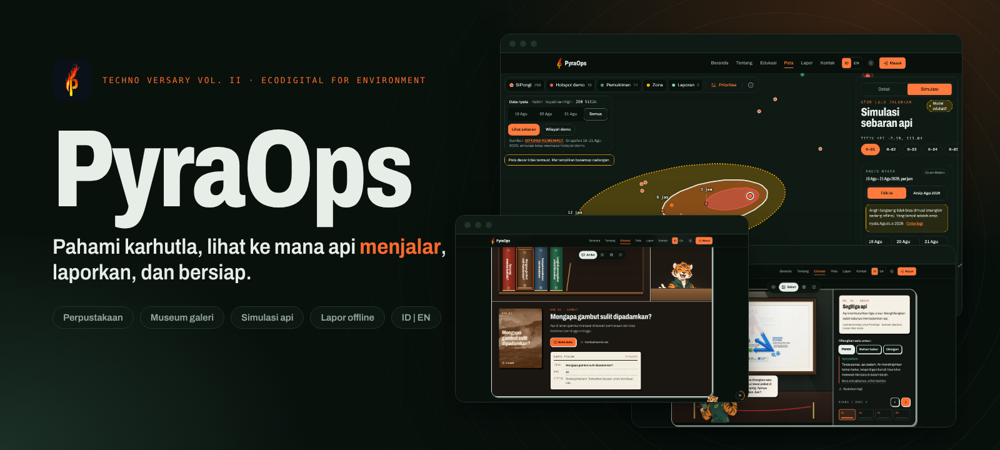
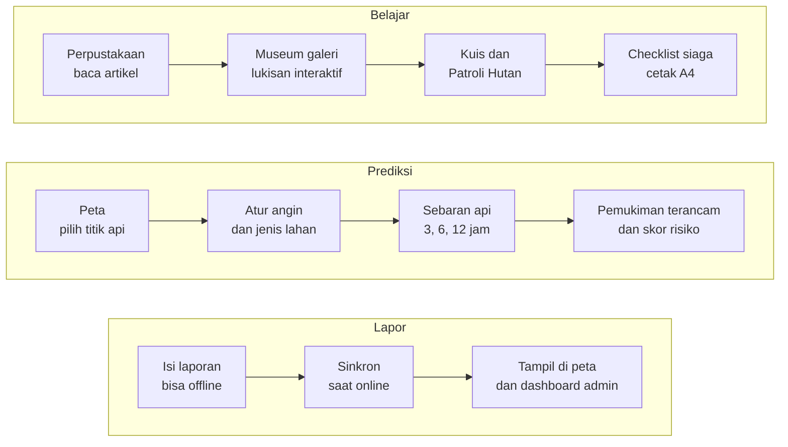

<div align="center">



<br>


**[Demo online](#demo-online)** · **[Masalah dan solusi](#masalah-dan-solusi)** · **[Isi situs](#isi-situs)** · **[Mulai cepat](#mulai-cepat)** · **[Tim](#tim)**

</div>

## Masalah dan solusi

| Masalah | Solusi di PyraOps |
|---|---|
| Peta titik panas menunjukkan *di mana* api muncul, tetapi tidak *ke mana* api bisa menjalar dan siapa yang terancam. | **Simulasi sebaran api** 3, 6, dan 12 jam di peta, dengan pengaturan angin dan jenis lahan, serta daftar pemukiman terancam beserta skor risikonya. |
| Informasi tentang penyebab, dampak, dan pencegahan karhutla tersebar dan terasa teknis bagi warga. | **Perpustakaan, museum galeri, kuis, dan game** yang menjelaskan dengan bahasa awam, bersumber, dan tersedia dalam dua bahasa. |
| Mengetahui bahaya belum berarti siap menghadapinya. | **Checklist siaga** untuk keluarga dan sekolah yang bisa dicentang dan dicetak sebagai lembar A4. |
| Di daerah rawan karhutla sinyal sering lemah, sehingga laporan sulit dikirim. | **Laporan lapangan offline**: ditulis tanpa sinyal, tersimpan di perangkat, dan terkirim sendiri saat online. |
| Konten edukasi perlu terus diperbarui. | **Dashboard admin** untuk menambah, menyunting, dan menerbitkan artikel, lukisan, soal kuis, dan butir persiapan. |

**Mengapa dibuat:** karhutla adalah isu lingkungan yang berulang, dan pemahaman warga menentukan seberapa cepat api dikenali, dilaporkan, dan dicegah. PyraOps mengumpulkan pemahaman itu, prediksi sederhana, dan alat bersiap dalam satu situs yang bisa dibuka siapa saja.

## Deskripsi website

PyraOps dimulai dari pertanyaan yang dekat dengan warga: *kenapa ini terjadi, apa yang terjadi pada udara dan tubuh kita, ke arah mana api bisa berjalan, dan apa yang bisa saya siapkan hari ini?*

Situs ini menyatukan lima hal dalam satu tempat: **bahan bacaan** yang bersumber, **galeri** yang bisa diajak berinteraksi, **simulasi sebaran api** di peta, **laporan lapangan** yang tetap bisa ditulis tanpa sinyal, dan **checklist siaga** yang bisa dicetak untuk keluarga atau sekolah. Maskot **TORA**, harimau sumatra, menemani pengunjung di tiap bagian.

Dibuat untuk **Techno Versary Vol. II, Web Design Competition** (tema *EcoDigital For Environment*), dengan sub-tema Edukasi Lingkungan, Portal Edukasi Lingkungan, Isu Lingkungan Global, dan Galeri Dokumentasi Alam.

### Demo online

**[pyraops.vercel.app](https://pyraops.vercel.app)**

> [!NOTE]
> Simulasi adalah model edukatif yang disederhanakan, bukan alat keputusan operasional. Titik panas simulasi, angin demo, dan pemukiman adalah data sampel berlabel. Data nyata (SiPongi, Open-Meteo) dicantumkan sumbernya di [Sumber data dan lisensi](#sumber-data-dan-lisensi).

## Isi situs

<details>
<summary><b>Alamat tiap ruang</b></summary>

<br>

| Ruang | Yang bisa dilakukan | Alamat |
|---|---|---|
| **Perpustakaan** | Ambil buku dari rak, baca artikel bersumber, ketuk istilah sulit untuk melihat artinya, mainkan widget perumpamaan, dan dapatkan kartu peminjaman bercap saat selesai. TORA jadi pustakawannya. | `/edukasi` |
| **Museum galeri** | Berjalan antar-lukisan bersama TORA. Hilangkan satu unsur segitiga api, sentuh titik gambut, atau geser arah angin langsung di bingkai. | `/edukasi?tab=galeri` |
| **Peta dan simulasi** | Pilih titik api, atur arah dan kecepatan angin, lihat sebaran 3, 6, dan 12 jam, dan cek pemukiman yang terancam. Ada layer titik panas nyata SiPongi dan tur terpandu. | `/peta` |
| **Patroli Hutan** | Game 2.5D: susuri hutan, temukan 5 titik api, pilih tindakan yang benar. | `/patroli` |
| **Kuis** | 8 soal dengan penjelasan dan sumber di tiap jawaban. | `/kuis` |
| **Siap siaga** | Checklist keluarga dan sekolah, tersimpan di perangkat, bisa dicetak sebagai lembar A4. | `/edukasi?tab=persiapan` |
| **Lapor** | Formulir laporan lapangan yang bekerja offline dan menyinkronkan diri saat sinyal kembali. | `/lapor` |
| **Dashboard admin** | Kelola artikel, lukisan, soal kuis, dan butir persiapan (terbit atau draf, unggah sampul), lihat laporan, pesan, dan peta risiko. | `/admin` |

</details>

Kuis dan Lapor memerlukan login demo (lihat [Mulai cepat](#mulai-cepat)). Halaman lain terbuka untuk semua. Situs juga punya tema terang dan gelap, dua bahasa (ID/EN), dan dapat dipasang di layar utama sebagai PWA.

### Tiga jalur untuk pengunjung

Pengunjung bisa mulai dari mana saja. Konten di jalur Belajar dikelola lewat dashboard admin (terbit atau draf), dan laporan dari jalur Lapor tampil di dashboard admin serta di layer *Laporan lapangan* pada peta.



## Mulai cepat

```bash
npm install
npm run dev
```

Buka `http://localhost:5173`. Tidak ada kunci atau layanan lain yang wajib. Untuk langsung melihat simulasi, buka `/peta?demo=1`.

**Akun demo** (untuk Kuis, Lapor, Akun, dan dashboard):

| Peran | Email | Kata sandi |
|---|---|---|
| Pengguna | `user@pyraops.id` | `Pengguna#2026` |
| Admin | `admin@pyraops.id` | `Admin#2026` |

## Kesesuaian dengan ketentuan lomba

| Ketentuan guidebook | Di PyraOps |
|---|---|
| Halaman Home, About, Konten/Artikel/Galeri, Contact | `/`, `/about`, `/edukasi` (artikel, galeri, kuis, persiapan) dan `/patroli`, `/contact` |
| Tema lingkungan | Karhutla: penyebab, dampak, pencegahan, simulasi, dan kesiapsiagaan |
| Framework gratis atau buatan sendiri, tanpa template atau komponen berbayar | React, Vite, Tailwind CSS, dan pustaka open-source; seluruh komponen UI ditulis sendiri |
| Karya orisinal | Dikerjakan tim; aset pihak lain berlisensi terbuka dan dikreditkan di [Sumber data dan lisensi](#sumber-data-dan-lisensi) |
| Folder `NamaTim_AsalInstansi_WebDesignTechnoversary_vol_II` | `NamaTim(OpsioNal)_UPNVeteranJawaTimur_WebDesignTechnoversary_vol.II` |
| README: judul, deskripsi, instalasi dan cara menjalankan | Bagian di atas dan [Instalasi](#instalasi) serta [Menjalankan](#menjalankan) |

## Tim

**PyraOps** · Techno Versary Vol. II

| Anggota | Peran | GitHub |
|---|---|---|
| Muhamad Musyaffa' Hadzaz Zaman | UI, peta, dan simulasi | [@MusHdzmn](https://github.com/MusHdzmn) |
| Lazuardi Aditya Pratama Putra | PWA, AI, dan konten | [@LazuardiAdityaPratamaPutra](https://github.com/LazuardiAdityaPratamaPutra) |

Kontak dan tautan tim ada di halaman **Kontak** (`/contact`).

## Instalasi

Prasyarat: **Node.js 20 atau lebih baru** dan npm.

```bash
git clone <url-repository-ini>
cd webdesign_PyraOps_technoversary_vol.II
npm install
cp .env.example .env     # opsional
```

`.env` hanya perlu bila kamu ingin briefing dan chatbot memakai Gemini. Tanpa kunci, keduanya otomatis memakai templat lokal dan semua fitur lain tetap berjalan.

| Variabel | Wajib | Keterangan |
|---|---|---|
| `GEMINI_API_KEY` | Tidak | Kunci dari Google AI Studio. Hanya dibaca di sisi server, tidak pernah masuk kode klien. |
| `GEMINI_MODEL` | Tidak | Nama model. Bawaan `gemini-3.5-flash-lite`. |

> [!CAUTION]
> `.env` berisi rahasia dan sudah diabaikan oleh `.gitignore`. Jangan pernah meng-commit-nya.

## Menjalankan

```bash
npm run dev          # pengembangan di http://localhost:5173
npm run build        # build produksi ke dist/
npm run preview      # menyajikan hasil build di http://localhost:4173 (service worker aktif)
npm test             # 446 uji: logika simulasi, dua bahasa, aksesibilitas axe-core
npm run lint         # ESLint
npm run cek:rilis    # pemeriksa kesiapan rilis dan kepatuhan lomba
```

<details>
<summary><b>Mencoba mode demo dan mode offline</b></summary>

<br>

- **Demo satu klik:** `/peta?demo=1` atau tombol *Demo Skenario* di Peta. Skenario contoh (titik api H-01, angin dari 80° 8 m/s, lahan semak) langsung disimulasikan tanpa jaringan.
- **Angin nyata:** di tab Simulasi, panel *Angin nyata* memuat angin per jam dari Open-Meteo. Tombol *Arsip Agu 2026* memakai data nyata 19–21 Agustus 2026 tanpa jaringan.
- **Tur:** tombol *Tur* di Peta memulai tur 5 langkah.
- **Offline:** jalankan `npm run build && npm run preview`, masuk dengan akun demo, buka `/lapor` sekali saat online. Lalu DevTools → Network → Offline, isi dan simpan laporan (status *Menunggu*). Saat kembali online, status menjadi *Tersinkron* dan titiknya muncul di layer *Laporan lapangan*.

</details>

<details>
<summary><b>Cara kerja simulasi</b></summary>

<br>

Model edukatif berbasis elips penjalaran yang mengikuti arah angin. Semua parameter ada di `src/lib/config.js` (nilai demo, **bukan** hasil kalibrasi lapangan).

Masukan: titik ignisi (lat, lon), kecepatan angin `U` (m/s), arah *asal* angin `θ` (derajat, 0 = utara), jenis lahan `F`, waktu `t` (jam).

| # | Rumus |
|---|---|
| 1 | `Rh = R0 × F × (1 + 0,3 × U)` dengan `R0 = 0,2 km/jam` (laju searah angin) |
| 2 | `Rb = 0,2 × Rh` (laju melawan angin) |
| 3 | `LW = min(4, 1 + 0,2 × U)` (rasio panjang:lebar; tanpa angin = lingkaran) |
| 4 | `ah = Rh × t`, `ab = Rb × t` |
| 5 | `a = (ah + ab) / 2`, `b = a / LW`, `c = (ah − ab) / 2` (pusat bergeser searah angin) |
| 6 | Arah penjalaran `φ = (θ + 180) mod 360` |
| 7 | Poligon elips 48 titik; 1° lintang ≈ 111,32 km, 1° bujur ≈ 111,32 × cos(lat) km |
| 8 | Luas = `turf.area / 10.000` (hektare) |

Faktor lahan `F`: hutan 1,0 · semak 1,3 · gambut (permukaan) 0,6 · pertanian 0,9.

Zona 3, 6, dan 12 jam selalu bersarang karena semuanya berskala linear dari titik ignisi. **Skor risiko pemukiman** (berbasis aturan, bukan ML): skor zona tercepat (3 jam = 100, 6 jam = 70, 12 jam = 40) × faktor kerentanan (kecil 0,8 · sedang 1,0 · besar 1,2 · sekolah/faskes 1,2), maksimum 100. Kritis ≥ 80, Tinggi 50–79, Waspada < 50.

**Batasan:** belum dikalibrasi dengan data kebakaran nyata; tidak memodelkan kelembapan bahan bakar, medan, penghalang alami, atau pemadaman; kebakaran gambut yang menjalar di bawah permukaan tidak dimodelkan. **Peran AI:** hanya merangkum hasil hitungan dan menjawab pertanyaan edukasi, dan keluarannya diperiksa agar tidak memuat angka di luar data masukan. AI tidak meramal.

</details>

<details>
<summary><b>Login demo dan dashboard admin</b></summary>

<br>

Situs punya login tanpa server (sesi tersimpan di perangkat) untuk memperagakan pemisahan tampilan:

| Peran | Email | Kata sandi | Setelah masuk |
|---|---|---|---|
| Pengguna | `user@pyraops.id` | `Pengguna#2026` | Situs publik, dengan akses Kuis, Lapor, dan halaman Akun |
| Admin | `admin@pyraops.id` | `Admin#2026` | Langsung ke `/admin` (hanya dashboard) |

| Fitur | Tamu | Akun pengguna |
|---|---|---|
| Progres bacaan, skor kuis, checklist | Tersimpan di ruang tamu | Ruang terpisah per akun |
| Simpan artikel | Terkunci (ajakan masuk) | Tombol Simpan + daftar di Akun |
| Kuis dan Lapor | Halaman ajakan masuk | Terbuka; laporan tercatat di "Laporan saya" |
| Formulir Kontak | Kosong | Nama dan email terisi |
| Halaman `/akun` | Diarahkan ke `/masuk` | Ringkasan progres, lanjutkan belajar, simpanan, riwayat |

Dashboard admin: ringkasan (termasuk titik panas nyata SiPongi yang sama dengan Peta pengunjung dan kemajuan belajar pengunjung di perangkat ini), laporan lapangan (status tindak lanjut), peta risiko (hotspot demo + layer SiPongi), konten edukasi, pesan dari form Kontak, dan log aktivitas. Konten edukasi bisa dibuat, disunting, dihapus, dan diterbitkan/dijadikan draf untuk keempat jenis: artikel (dengan gambar sampul), lukisan galeri (unggah gambar), soal kuis, dan butir persiapan. Tombol **Lihat sebagai pengunjung** membuka situs dalam mode pratinjau untuk mengecek hasilnya.

> [!WARNING]
> Karena tanpa server, perubahan admin dan progres pengunjung hanya terlihat di peramban yang sama (bukan di perangkat atau jendela penyamaran lain). Ini peragaan pemisahan peran, bukan keamanan sungguhan: kata sandi ada di kode klien dan data hanya tersimpan di perangkat. Untuk produksi, ganti dengan autentikasi dan basis data di server.

</details>

<details>
<summary><b>Dua bahasa (ID/EN)</b></summary>

<br>

Tombol **ID | EN** di navbar mengganti seluruh antarmuka dan konten: halaman, artikel, kuis, checklist, galeri, tur, briefing, dan chatbot. Pilihan tersimpan di perangkat dan atribut `lang` pada `<html>` ikut berubah. Briefing dan chatbot AI menjawab dalam bahasa yang dipilih, dan pemeriksa angka tetap berlaku untuk format angka kedua bahasa.

- Teks komponen memakai `tr('teks Indonesia', 'English text')` dari `src/i18n`; teks yang dipakai di banyak tempat ada di `src/i18n/id.js` dan `en.js`.
- Konten bilingual berada di `src/data/*.js` (bidang `en`) dan artikel Inggris di `src/data/artikel/en/*.md` (slug sama dengan versi Indonesia).
- Menambah bahasa atau teks baru: uji `tests/i18n.test.js` memeriksa paritas data dan `tests/a11y.test.jsx` merender setiap halaman dalam bahasa Inggris, lalu **gagal bila masih ada kata Indonesia** pada teks yang tampil. Halaman `/styleguide` adalah halaman internal pengembang dan hanya berbahasa Indonesia.

</details>

<details>
<summary><b>Arsitektur dan struktur folder</b></summary>

<br>

Client-heavy, serverless seminimal mungkin, tanpa database server: data statis JSON → klien → mesin simulasi → Turf → layer peta. Hanya tiga fungsi serverless (`api/sync.js`, `api/briefing.js`, `api/chat.js`). Semua fitur inti berjalan tanpa API eksternal; briefing dan chat punya cadangan lokal. Konten admin, progres belajar, dan laporan tersimpan di perangkat (localStorage dan IndexedDB).

```
api/                  Vercel Functions (sinkronisasi demo, briefing, chat Gemini)
docs/                 QA.md (checklist uji manual), MASKOT.md, KREDIT-FOTO.md, PENGUMPULAN.md, screenshots/
public/               ikon PWA, favicon, robots.txt, foto latar, model 3D
scripts/              cek-rilis.mjs, analisis-bundel.mjs
src/
  components/         Navbar, Footer, MapView, SimulationPanel, RiskList, BriefingPanel, Tur,
                      Perpustakaan, Galeri (museum), Checklist, LembarCetak, Kuis, Maskot, hero3d/, ui/ ...
  data/               hotspot.json, pemukiman.json, basemap.geojson, artikel/*.md (+ en/),
                      kuis.js, checklist.js, galeri.js, perpustakaan.js, kredit.js, tim.js, statistik.js, ...
  i18n/               kamus bersama ID/EN dan hook tr() / useBahasa()
  lib/                simulasi.js, risiko.js, config.js, db.js, sync.js, briefing.js, chat.js,
                      kontenStore.js, kontenEdukasi.js, admin.js, progres.js, gemini.js (server), ...
  pages/              Home, About, Edukasi, ArtikelDetail, Peta, Lapor, Patroli, KuisGame, Contact,
                      Masuk, Akun, Styleguide, admin/ (Ringkasan, Laporan, PetaAdmin, Konten, Pesan, Aktivitas)
tests/                uji unit, uji data, audit aksesibilitas axe-core (446 uji)
```

</details>


## Sumber data dan lisensi

| Data | Status |
|---|---|
| Titik panas simulasi (hotspot) | **Data demo** (sampel ilustrasi; bukan arsip NASA FIRMS). |
| Pemukiman | **Data ilustrasi** buatan tim, bukan data kependudukan. |
| Angin per hotspot | **Data demo** (nilai bawaan tiap titik api). |
| Titik panas nyata (layer *SiPongi* di Peta dan dashboard admin) | **Data nyata** dari SiPongi KEMENHUT: sebaran titik panas Kalimantan Timur, keyakinan *High*, 19–21 Agustus 2026 (260 titik). Wajib mencantumkan sumber: SiPongi KEMENHUT. |
| Statistik luas kebakaran nasional (Beranda) | **Data nyata** dari SiPongi KEMENHUT (2026 dan 2025), dengan sumber pada tiap angka. |
| Angin nyata (panel *Angin nyata* di tab Simulasi) | **Data nyata** dari [Open-Meteo](https://open-meteo.com) (CC BY 4.0), untuk koordinat titik api mana pun di Indonesia: kecepatan dan arah angin 10 m per jam selama 72 jam (kemarin, hari ini, besok), diambil langsung dari peramban tanpa kunci API. Bila offline, panel memakai **arsip nyata** 19–21 Agustus 2026 sekitar Tanjung Batu, Pulau Derawan, Berau (`src/data/angin.js`, disalin apa adanya dari Historical Weather API). |
| Tile peta | © OpenStreetMap contributors (ODbL). |
| Model 3D (pohon, semak, batu, tenda, bangunan, truk) | Kenney Nature Kit, City Kit, Car Kit, **CC0 1.0** (kenney.nl). |
| Maskot TORA | Ilustrasi tim; pembuat dan lisensinya dicatat di `src/data/kredit.js`. |

Statistik pada halaman Home dan isi artikel mencantumkan sumber yang dapat diverifikasi. Daftar lengkap kredit font, ikon, pustaka, dan aset ada di halaman **Tentang → Kredit** (`/about#kredit`, sumber data: `src/data/kredit.js`).

## Catatan pengembangan

- **Isi artikel dan kuis.** Artikel dan sumber kuis ditulis dari rujukan yang dibuka dan dibaca langsung (jurnal, Bank Dunia, WHO, NASA, kementerian, BMKG, IPB, ITB, UGM). Daftar lengkapnya ada di bagian Sumber tiap artikel dan di halaman Tentang → Kredit. Angka yang berupa perkiraan model (misalnya kematian dini akibat kabut asap) diberi keterangan sebagai perkiraan.
- **Fitur AI di dalam produk.** Briefing dan chatbot edukasi memakai Gemini bila kunci API diisi; tanpa kunci, keduanya memakai templat lokal. Keluaran AI selalu berlabel.
- **Data demo.** Titik panas simulasi, pemukiman, dan angin demo adalah data ilustrasi buatan tim (lihat tabel Sumber data); laporan dan pesan pada dashboard admin adalah contoh yang tersimpan di perangkat.
- **Pengujian.** `npm test` menjalankan 446 uji (logika simulasi, paritas dua bahasa, aturan token warna, audit aksesibilitas axe-core pada setiap halaman); `npm run lint` bersih. Uji manual lintas peramban dan perangkat ada di `docs/QA.md`.
- **Pembagian kerja** mengikuti tabel [Tim](#tim) di atas.
