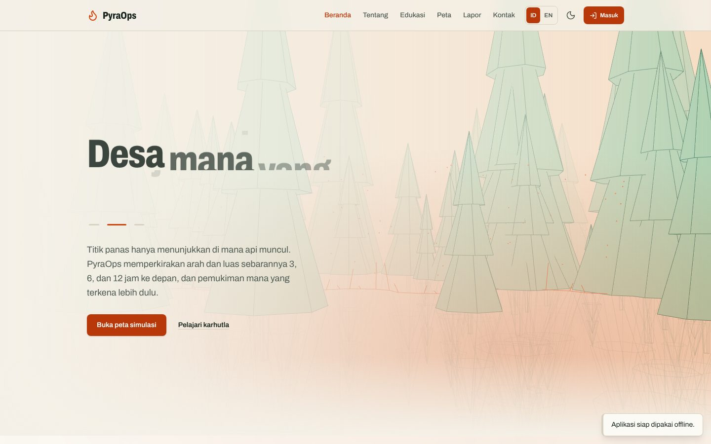
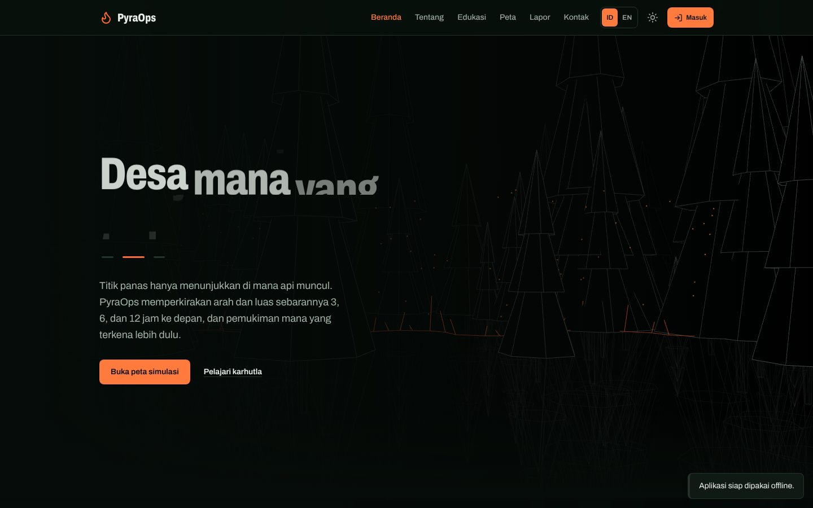
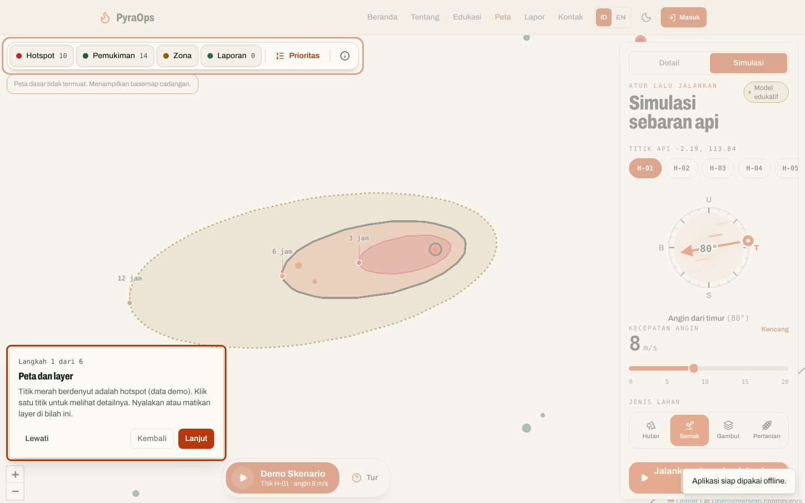
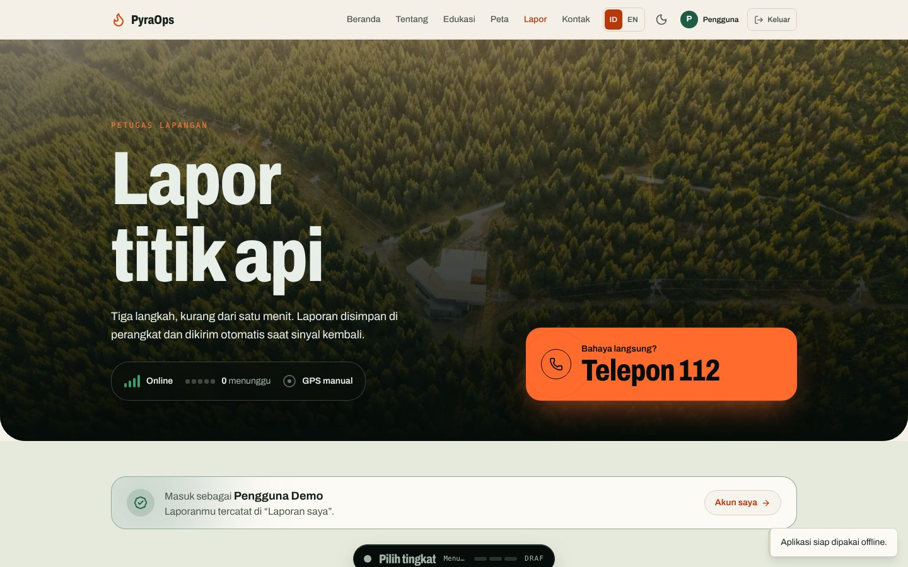
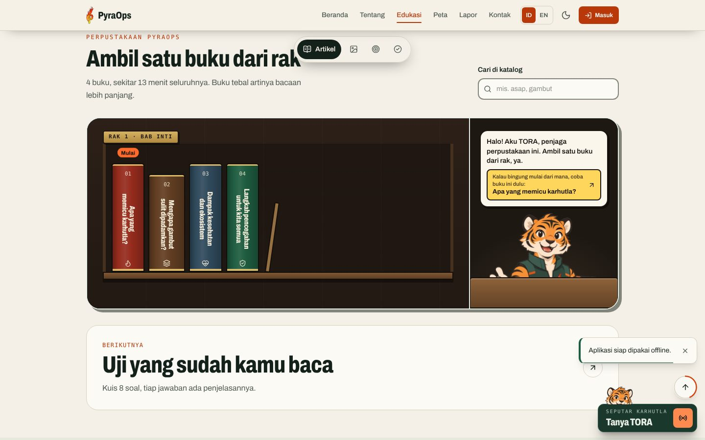
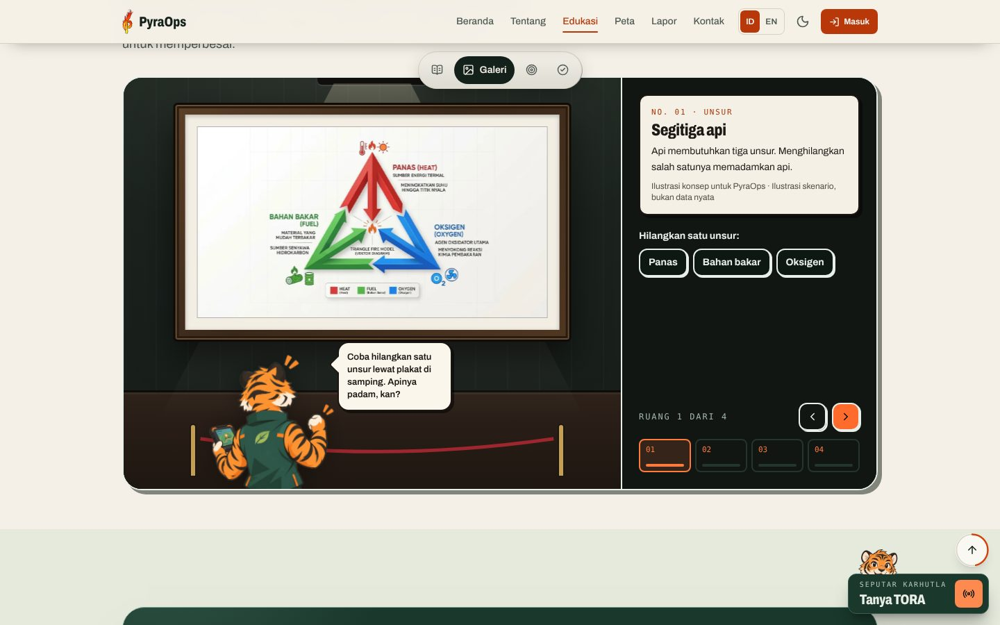
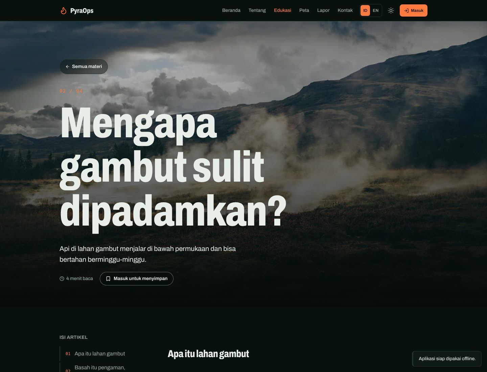
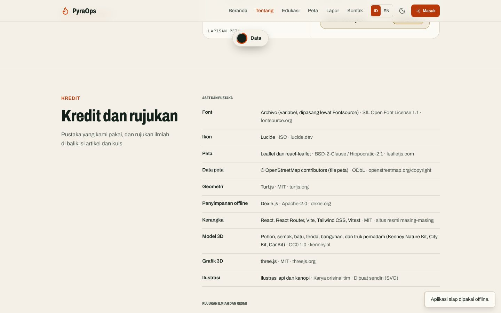
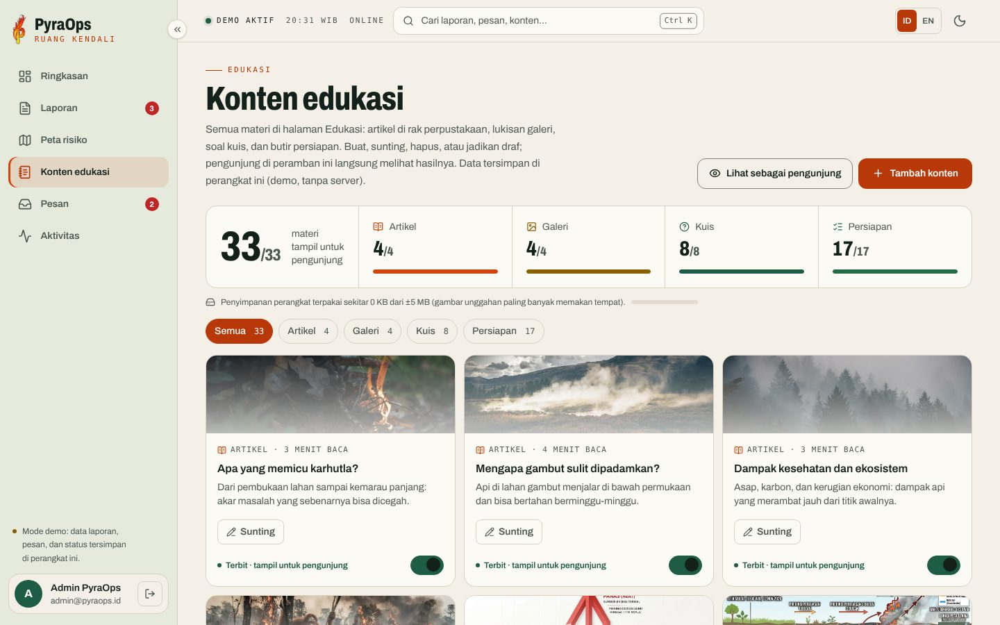

# PyraOps

> **Bukan hanya melihat api, tapi tahu ke mana api akan pergi.**

**Judul website:** PyraOps, Edukasi dan Simulasi Karhutla
**Karya untuk:** Techno Versary Vol. II, Web Design Competition (HIMA-TI FKOM UNIKU), tema *EcoDigital For Environment*
**Demo online:** [URL DEMO ONLINE]

## Deskripsi website

PyraOps adalah **portal edukasi lingkungan** tentang kebakaran hutan dan lahan (karhutla) di Indonesia, dilengkapi pusat simulasi. Peta titik panas biasa menjawab *di mana* api muncul; PyraOps menambahkan *ke mana* api dapat menjalar dan siapa yang berada di jalurnya, lalu membantu orang memahami penyebab, dampak, dan pencegahannya lewat bacaan, galeri, kuis, game, dan checklist kesiapsiagaan yang dapat dicetak.

- **Sub-tema lomba:** Edukasi Lingkungan · Portal Edukasi Lingkungan · Isu Lingkungan Global · Galeri Dokumentasi tentang Alam dan Pelestarian Lingkungan.
- **Sasaran:** masyarakat umum, keluarga, sekolah, dan relawan di daerah rawan karhutla.
- **Pendekatan:** belajar sambil melakukan. Pengunjung membuka buku di perpustakaan, berkeliling di museum galeri bersama maskot TORA (harimau sumatra), menjalankan simulasi sebaran api di peta, lalu menyusun rencana siaga untuk keluarganya.

> ⚠️ **Disclaimer.** Simulasi ini adalah model edukatif yang disederhanakan. Tidak memperhitungkan seluruh faktor lapangan (kelembapan bahan bakar, kebakaran bawah permukaan gambut, penghalang alami, upaya pemadaman) dan tidak dimaksudkan sebagai dasar keputusan operasional. Titik panas demo, angin demo, dan pemukiman dalam simulasi adalah **data sampel berlabel**; data nyata (SiPongi, Open-Meteo) dicantumkan sumbernya di bagian [Sumber data dan lisensi](#sumber-data-dan-lisensi).

## Tim

**Nama tim: Nama Tim(Opsional)** · Techno Versary Vol. II

| Anggota | Peran |
|---|---|
| Muhamad Musyaffa' Hadzaz Zaman | UI, Peta, dan Simulasi |
| Lazuardi Aditya Pratama Putra | PWA, AI, dan Konten |

Kontak dan tautan tim: halaman **Kontak** (`/contact`).

## Kesesuaian dengan ketentuan lomba

| Ketentuan guidebook | Di PyraOps |
|---|---|
| Halaman **Home** | `/` |
| Halaman **About** | `/about` (termasuk Kredit dan rujukan) |
| Halaman **Konten / Artikel / Galeri** | `/edukasi` (artikel di perpustakaan, galeri museum, kuis, persiapan), `/edukasi/:slug` (artikel), `/patroli` (game) |
| Halaman **Contact** | `/contact` |
| Tema lingkungan | Karhutla: penyebab, dampak, pencegahan, dan simulasi sebaran api |
| Framework/library gratis atau buatan sendiri | React, Vite, Tailwind CSS, dan pustaka open-source lain (lihat [Teknologi](#teknologi)); seluruh komponen UI ditulis sendiri |
| Tanpa template atau komponen berbayar | Tidak memakai template, tema, atau komponen premium; kredit lengkap di `src/data/kredit.js` |
| Karya orisinal | Dikerjakan tim; aset pihak lain berlisensi terbuka dan dikreditkan (lihat [Sumber data dan lisensi](#sumber-data-dan-lisensi)) |
| Folder `webdesign_namaTim_technoversary_vol.II` | `webdesign_PyraOps_technoversary_vol.II` |
| README: judul, deskripsi, instalasi dan cara menjalankan, nama tim dan anggota | Bagian di atas dan [Instalasi](#instalasi) serta [Menjalankan](#menjalankan) di bawah |

## Tangkapan layar

| | |
|---|---|
|  |  |
|  |  |
|  |  |
|  |  |
|  | |

Tampilan ponsel (lebar 390 px): [Peta dan simulasi](docs/screenshots/09-ponsel-peta.jpg).

## Fitur

| Pilar | Fitur |
|---|---|
| **Prediksi** | Peta Leaflet dengan simulasi sebaran api 3, 6, dan 12 jam; slider waktu; skenario "what-if" arah dan kecepatan angin; deteksi pemukiman terancam dengan skor risiko (Kritis / Tinggi / Waspada); briefing situasi dalam bahasa awam; layer titik panas nyata SiPongi (Kalimantan Timur). |
| **Resilien** | Progressive Web App: form laporan lapangan yang tetap bisa diisi tanpa sinyal (IndexedDB), antrean sinkronisasi otomatis saat online, dapat dipasang di layar utama. |
| **Edukasi** | **Perpustakaan** berisi rak buku artikel yang dapat dibuka (glosarium sentuh, widget perumpamaan, kartu peminjaman dengan cap); **museum galeri** dengan lukisan interaktif; kuis 8 soal; **checklist kesiapsiagaan** untuk keluarga dan sekolah yang dapat dicetak sebagai lembar A4; chatbot "Tanya TORA" dibatasi pada topik karhutla. |
| **Patroli Hutan** | Game edukasi 2.5D (`/patroli`): TORA berjalan menyusuri hutan berlapis paralaks, menemukan 5 titik api, lalu memilih tindakan yang benar (lapor ke 112/BPBD, tidak membakar lahan, verifikasi hotspot, dan seterusnya). Penjelasan dan sumber tiap situasi diambil dari soal kuis. Terbuka untuk semua; skor terbaik tersimpan di perangkat. |
| **Dashboard admin** | Ringkasan data, laporan lapangan, peta risiko, pesan, log aktivitas, dan CRUD konten edukasi (artikel, lukisan galeri, soal kuis, butir persiapan) dengan status terbit/draf dan unggah gambar sampul. Lihat [Login demo dan dashboard admin](#login-demo-dan-dashboard-admin). |

Halaman: `/` Home · `/about` Tentang (termasuk Kredit) · `/edukasi` Artikel, Galeri, Kuis, Persiapan · `/patroli` Game Patroli Hutan · `/peta` Peta dan simulasi · `/lapor` Lapor lapangan · `/contact` Kontak · `/masuk` dan `/akun` Masuk dan akun demo · `/admin` dashboard admin. Halaman Home, About, Edukasi, artikel, Patroli, Peta, dan Kontak terbuka tanpa login; **Kuis** dan **Lapor** memerlukan login demo (tamu melihat halaman ajakan masuk).

Maskot **TORA** (harimau sumatra, Forest Companion) hadir sebagai asisten melayang "Pos Jaga TORA" di pojok kanan bawah situs publik, sebagai pustakawan dan pemandu museum di Edukasi, dan di momen kemajuan (hasil kuis, checklist selesai, laporan diterima server); lihat `docs/MASKOT.md`.

Tersedia juga mode tema terang/gelap, **dua bahasa (Indonesia / English)**, mode demo satu klik, dan tur terpandu di Peta.

## Teknologi

React 18 · Vite 6 · Tailwind CSS 4 · React Router 6 · Leaflet + react-leaflet (tile OpenStreetMap) · Turf.js (impor modular) · three.js (latar 3D di Beranda dan Tentang) · Dexie.js (IndexedDB) · vite-plugin-pwa (Workbox) · Vitest · axe-core · Lucide (ikon) · font Archivo (Fontsource) · Gemini API lewat fungsi serverless Vercel.

Seluruh komponen UI ditulis sendiri; tidak ada template, tema, atau komponen premium/berbayar.

## Dua bahasa (ID/EN)

Tombol **ID | EN** di navbar mengganti seluruh antarmuka dan konten: halaman, artikel, kuis, checklist, galeri, tur, briefing, dan chatbot. Pilihan tersimpan di perangkat dan atribut `lang` pada `<html>` ikut berubah. Briefing dan chatbot AI menjawab dalam bahasa yang dipilih, dan pemeriksa angka tetap berlaku untuk format angka kedua bahasa.

- Teks komponen memakai `tr('teks Indonesia', 'English text')` dari `src/i18n`; teks yang dipakai di banyak tempat ada di `src/i18n/id.js` dan `en.js`.
- Konten bilingual berada di `src/data/*.js` (bidang `en`) dan artikel Inggris di `src/data/artikel/en/*.md` (slug sama dengan versi Indonesia).
- Menambah bahasa atau teks baru: uji `tests/i18n.test.js` memeriksa paritas data dan `tests/a11y.test.jsx` merender setiap halaman dalam bahasa Inggris, lalu **gagal bila masih ada kata Indonesia** pada teks yang tampil. Halaman `/styleguide` adalah halaman internal pengembang dan hanya berbahasa Indonesia.

## Instalasi

Prasyarat: **Node.js 20 atau lebih baru** dan npm.

```bash
git clone <url-repository-ini>
cd webdesign_PyraOps_technoversary_vol.II
npm install
cp .env.example .env     # opsional: isi GEMINI_API_KEY (lihat tabel di bawah)
```

| Variabel | Wajib | Keterangan |
|---|---|---|
| `GEMINI_API_KEY` | Tidak | Kunci Gemini dari Google AI Studio. Tanpa kunci, briefing dan chatbot otomatis memakai **mode cadangan** (templat lokal); semua fitur inti tetap berjalan. Tidak pernah dimasukkan ke kode klien. |
| `GEMINI_MODEL` | Tidak | Nama model Gemini. Bawaan: `gemini-2.5-flash`. Cek daftar model dan kuota gratis terbaru di Google AI Studio. |

> Berkas `.env` berisi rahasia dan sudah diabaikan oleh `.gitignore`. Jangan pernah meng-commit-nya.

## Menjalankan

```bash
npm run dev          # server pengembangan di http://localhost:5173 (termasuk /api/sync, /api/briefing, /api/chat lokal)
npm run build        # build produksi ke dist/
npm run preview      # menyajikan hasil build di http://localhost:4173 (service worker aktif hanya pada build)
npm test             # uji unit + audit aksesibilitas (axe-core)
npm run lint         # ESLint
npm run analisis     # ukuran isi bundel per paket
npm run cek:rilis    # pemeriksa kesiapan rilis dan kepatuhan lomba
```

Cara tercepat melihat hasilnya: `npm install && npm run dev`, lalu buka `http://localhost:5173`. Tidak ada kunci atau layanan lain yang wajib.

### Mencoba mode demo

- Buka **`/peta?demo=1`**, atau tekan tombol **Demo Skenario** di halaman Peta. Skenario contoh (titik api H-01, angin dari 80° 8 m/s, lahan semak) langsung disimulasikan dan daftar risiko terbuka. Berjalan tanpa jaringan.
- Di tab **Simulasi**, panel **Angin nyata** memuat angin per jam (3 hari) di lokasi titik api yang dipilih, dari Open-Meteo: pilih hari atau geser jamnya, dan kecepatan serta arah angin simulasi terisi dari data. Tombol *Arsip Agu 2026* memakai data nyata 19–21 Agustus 2026 tanpa jaringan.
- Tombol **Tur** di Peta memulai tur terpandu 5 langkah (dapat dilewati dan diulang).
- Untuk **Kuis**, **Lapor**, dan **Akun**, masuk dengan akun demo di bagian [Login demo dan dashboard admin](#login-demo-dan-dashboard-admin).

### Mencoba mode offline

1. `npm run build && npm run preview`, masuk dengan akun demo, buka `/lapor` di Chrome, **kunjungi sekali saat online**.
2. DevTools → Network → **Offline**, muat ulang: aplikasi tetap terbuka.
3. Isi dan simpan laporan: statusnya **Menunggu**.
4. Kembali **Online**: dalam beberapa detik status menjadi **Tersinkron**, dan titiknya muncul di layer *Laporan lapangan* pada `/peta`.

## Cara kerja simulasi

Model edukatif berbasis elips penjalaran yang mengikuti arah angin. Semua parameter ada di `src/lib/config.js` (nilai demo, **bukan** hasil kalibrasi lapangan).

Masukan: titik ignisi (lat, lon), kecepatan angin `U` (m/s), arah *asal* angin `θ` (derajat, 0 = utara), jenis lahan `F`, waktu `t` (jam).

| # | Rumus |
|---|---|
| 1 | `Rh = R0 × F × (1 + 0,3 × U)` dengan `R0 = 0,2 km/jam` (laju searah angin) |
| 2 | `Rb = 0,2 × Rh` (laju melawan angin) |
| 3 | `LW = min(4, 1 + 0,2 × U)` (rasio panjang:lebar; tanpa angin = lingkaran) |
| 4 | `ah = Rh × t`, `ab = Rb × t` |
| 5 | `a = (ah + ab) / 2`, `b = a / LW`, `c = (ah − ab) / 2` (pusat bergeser searah angin) |
| 6 | Arah penjalaran `φ = (θ + 180) mod 360` |
| 7 | Poligon elips 48 titik; 1° lintang ≈ 111,32 km, 1° bujur ≈ 111,32 × cos(lat) km |
| 8 | Luas = `turf.area / 10.000` (hektare) |

Faktor lahan `F`: hutan 1,0 · semak 1,3 · gambut (permukaan) 0,6 · pertanian 0,9.

Zona 3, 6, dan 12 jam selalu bersarang karena semuanya berskala linear dari titik ignisi. **Skor risiko pemukiman** (berbasis aturan, bukan ML): skor zona tercepat (3 jam = 100, 6 jam = 70, 12 jam = 40) × faktor kerentanan (kecil 0,8 · sedang 1,0 · besar 1,2 · sekolah/faskes 1,2), maksimum 100. Kritis ≥ 80, Tinggi 50–79, Waspada < 50.

**Batasan:** belum dikalibrasi dengan data kebakaran nyata; tidak memodelkan kelembapan bahan bakar, medan, penghalang alami, atau pemadaman; kebakaran gambut yang menjalar di bawah permukaan tidak dimodelkan. **Peran AI:** hanya merangkum hasil hitungan dan menjawab pertanyaan edukasi, dan keluarannya diperiksa agar tidak memuat angka di luar data masukan. AI tidak meramal.

## Arsitektur

Client-heavy, serverless seminimal mungkin, tanpa database server: data statis JSON → klien → mesin simulasi → Turf → layer peta. Hanya tiga fungsi serverless (`api/sync.js`, `api/briefing.js`, `api/chat.js`). Semua fitur inti berjalan tanpa API eksternal; briefing dan chat punya cadangan lokal. Konten admin, progres belajar, dan laporan tersimpan di perangkat (localStorage dan IndexedDB).

```
api/                  Vercel Functions (sinkronisasi demo, briefing, chat Gemini)
docs/                 QA.md (checklist uji manual), MASKOT.md, KREDIT-FOTO.md, PENGUMPULAN.md, screenshots/
public/               ikon PWA, favicon, robots.txt, foto latar, model 3D
scripts/              cek-rilis.mjs, analisis-bundel.mjs
src/
  components/         Navbar, Footer, MapView, SimulationPanel, RiskList, BriefingPanel, Tur,
                      Perpustakaan, Galeri (museum), Checklist, LembarCetak, Kuis, Maskot, hero3d/, ui/ ...
  data/               hotspot.json, pemukiman.json, basemap.geojson, artikel/*.md (+ en/),
                      kuis.js, checklist.js, galeri.js, perpustakaan.js, kredit.js, tim.js, statistik.js, ...
  i18n/               kamus bersama ID/EN dan hook tr() / useBahasa()
  lib/                simulasi.js, risiko.js, config.js, db.js, sync.js, briefing.js, chat.js,
                      kontenStore.js, kontenEdukasi.js, admin.js, progres.js, gemini.js (server), ...
  pages/              Home, About, Edukasi, ArtikelDetail, Peta, Lapor, Patroli, KuisGame, Contact,
                      Masuk, Akun, Styleguide, admin/ (Ringkasan, Laporan, PetaAdmin, Konten, Pesan, Aktivitas)
tests/                uji unit, uji data, audit aksesibilitas axe-core (446 uji)
```

## Login demo dan dashboard admin

Situs punya login tanpa server (sesi tersimpan di perangkat) untuk memperagakan pemisahan tampilan:

| Peran | Email | Kata sandi | Setelah masuk |
|---|---|---|---|
| Pengguna | `user@pyraops.id` | `Pengguna#2026` | Situs publik, dengan akses Kuis, Lapor, dan halaman Akun |
| Admin | `admin@pyraops.id` | `Admin#2026` | Langsung ke `/admin` (hanya dashboard) |

| Fitur | Tamu | Akun pengguna |
|---|---|---|
| Progres bacaan, skor kuis, checklist | Tersimpan di ruang tamu | Ruang terpisah per akun |
| Simpan artikel | Terkunci (ajakan masuk) | Tombol Simpan + daftar di Akun |
| Kuis dan Lapor | Halaman ajakan masuk | Terbuka; laporan tercatat di "Laporan saya" |
| Formulir Kontak | Kosong | Nama dan email terisi |
| Halaman `/akun` | Diarahkan ke `/masuk` | Ringkasan progres, lanjutkan belajar, simpanan, riwayat |

Dashboard admin: ringkasan (termasuk titik panas nyata SiPongi yang sama dengan Peta pengunjung dan kemajuan belajar pengunjung di perangkat ini), laporan lapangan (status tindak lanjut), peta risiko (hotspot demo + layer SiPongi), konten edukasi, pesan dari form Kontak, dan log aktivitas. Konten edukasi bisa dibuat, disunting, dihapus, dan diterbitkan/dijadikan draf untuk keempat jenis: artikel (dengan gambar sampul), lukisan galeri (unggah gambar), soal kuis, dan butir persiapan. Tombol **Lihat sebagai pengunjung** membuka situs dalam mode pratinjau untuk mengecek hasilnya.

> **Batasan demo.** Karena tanpa server, perubahan admin dan progres pengunjung hanya terlihat di peramban yang sama (bukan di perangkat atau jendela penyamaran lain). Ini peragaan pemisahan peran, bukan keamanan sungguhan: kata sandi ada di kode klien dan data hanya tersimpan di perangkat. Untuk produksi, ganti dengan autentikasi dan basis data di server.

## Deploy ke Vercel (disarankan)

1. Impor repository ke Vercel (framework terdeteksi sebagai Vite; build `npm run build`, output `dist`).
2. *Settings → Environment Variables*: isi `GEMINI_API_KEY` (dan `GEMINI_MODEL` bila perlu). Boleh dikosongkan; fitur AI akan memakai mode cadangan.
3. Deploy. HTTPS otomatis (wajib untuk service worker dan GPS).
4. Verifikasi: buka situs di perangkat bersih, cek `/peta?demo=1`, uji offline di `/lapor`, dan (bila kunci diisi) tombol **Buat briefing** harus berlabel *Dibuat otomatis oleh AI*.
5. Tempel URL hasil deploy pada baris **Demo online** di bagian atas README ini.

`vercel.json` sudah mengatur fallback SPA, header cache (service worker tidak di-cache lama, aset ber-hash di-cache panjang), dan batas durasi fungsi. GitHub Pages hanya statis: fungsi serverless tidak berjalan, sehingga briefing dan chat selalu memakai mode cadangan dan sinkronisasi laporan dicatat sebagai "server demo lokal". Hosting bersifat opsional menurut guidebook; juri dapat menjalankan proyek dari repository dengan langkah [Instalasi](#instalasi).

Daftar periksa pengumpulan (nama folder, repository GitHub, kunci API, placeholder) ada di [`docs/PENGUMPULAN.md`](docs/PENGUMPULAN.md).

## Sumber data dan lisensi

| Data | Status |
|---|---|
| Titik panas simulasi (hotspot) | **Data demo** (sampel ilustrasi; bukan arsip NASA FIRMS). |
| Pemukiman | **Data ilustrasi** buatan tim, bukan data kependudukan. |
| Angin per hotspot | **Data demo** (nilai bawaan tiap titik api). |
| Titik panas nyata (layer *SiPongi* di Peta dan dashboard admin) | **Data nyata** dari SiPongi KEMENHUT: sebaran titik panas Kalimantan Timur, keyakinan *High*, 19–21 Agustus 2026 (260 titik). Wajib mencantumkan sumber: SiPongi KEMENHUT. |
| Statistik luas kebakaran nasional (Beranda) | **Data nyata** dari SiPongi KEMENHUT (2026 dan 2025), dengan sumber pada tiap angka. |
| Angin nyata (panel *Angin nyata* di tab Simulasi) | **Data nyata** dari [Open-Meteo](https://open-meteo.com) (CC BY 4.0), untuk koordinat titik api mana pun di Indonesia: kecepatan dan arah angin 10 m per jam selama 72 jam (kemarin, hari ini, besok), diambil langsung dari peramban tanpa kunci API. Bila offline, panel memakai **arsip nyata** 19–21 Agustus 2026 sekitar Tanjung Batu, Pulau Derawan, Berau (`src/data/angin.js`, disalin apa adanya dari Historical Weather API). |
| Tile peta | © OpenStreetMap contributors (ODbL). |
| Model 3D (pohon, semak, batu, tenda, bangunan, truk) | Kenney Nature Kit, City Kit, Car Kit, **CC0 1.0** (kenney.nl). |
| Maskot TORA | Ilustrasi tim; pembuat dan lisensinya dicatat di `src/data/kredit.js`. |

Statistik pada halaman Home dan isi artikel mencantumkan sumber yang dapat diverifikasi. Daftar lengkap kredit font, ikon, pustaka, dan aset ada di halaman **Tentang → Kredit** (`/about#kredit`, sumber data: `src/data/kredit.js`).

## Catatan pengembangan

- **Isi artikel dan kuis.** Artikel dan sumber kuis ditulis dari rujukan yang dibuka dan dibaca langsung (jurnal, Bank Dunia, WHO, NASA, kementerian, BMKG, IPB, ITB, UGM). Daftar lengkapnya ada di bagian Sumber tiap artikel dan di halaman Tentang → Kredit. Angka yang berupa perkiraan model (misalnya kematian dini akibat kabut asap) diberi keterangan sebagai perkiraan.
- **Fitur AI di dalam produk.** Briefing dan chatbot edukasi memakai Gemini bila kunci API diisi; tanpa kunci, keduanya memakai templat lokal. Keluaran AI selalu berlabel.
- **Data demo.** Titik panas simulasi, pemukiman, dan angin demo adalah data ilustrasi buatan tim (lihat tabel Sumber data); laporan dan pesan pada dashboard admin adalah contoh yang tersimpan di perangkat.
- **Pengujian.** `npm test` menjalankan 446 uji (logika simulasi, paritas dua bahasa, aturan token warna, audit aksesibilitas axe-core pada setiap halaman); `npm run lint` bersih. Uji manual lintas peramban dan perangkat ada di `docs/QA.md`.
- **Pembagian kerja** mengikuti tabel [Tim](#tim) di atas.
