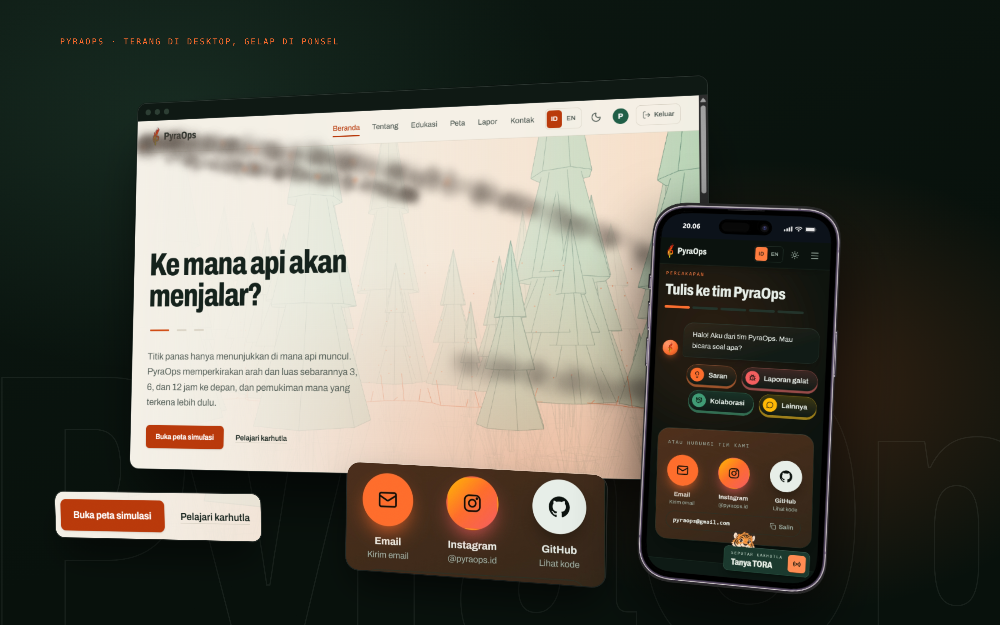
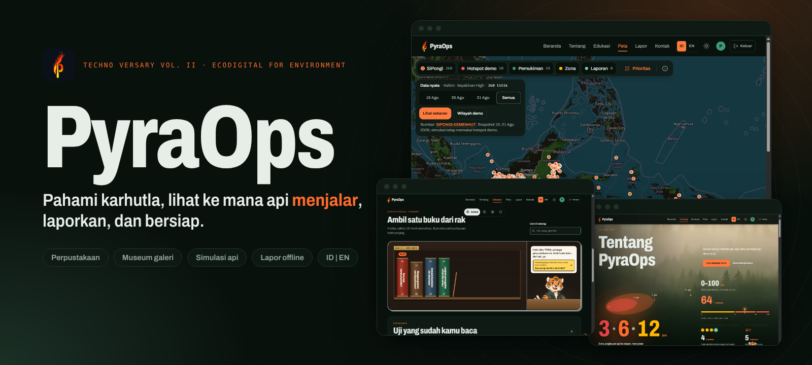
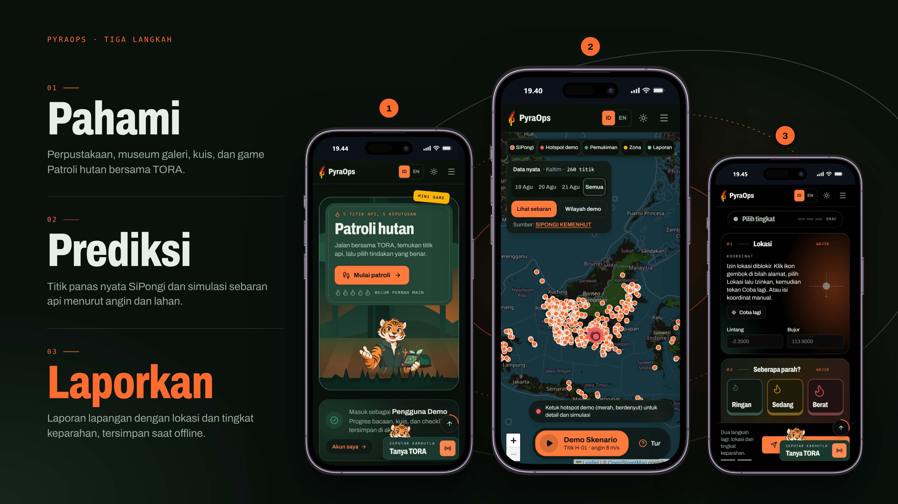

<div align="center">


# 🔥 PyraOps

### Edukasi dan Simulasi Kebakaran Hutan dan Lahan (Karhutla)

*Bukan hanya melihat api, tapi tahu ke mana api akan pergi.*

<br />

[](https://pyraops.vercel.app/)
[](#-informasi-tim)
[](https://pyraops.vercel.app/)


<br />

[**🚀 Buka Website**](https://pyraops.vercel.app/) &nbsp;•&nbsp; [**✨ Fitur**](#-fitur-utama) &nbsp;•&nbsp; [**🛠️ Tech Stack**](#️-tech-stack) &nbsp;•&nbsp; [**⚙️ Instalasi**](#️-petunjuk-instalasi) &nbsp;•&nbsp; [**👥 Tim**](#-informasi-tim)

</div>

---

## 📖 Deskripsi Website

**PyraOps** adalah website edukasi lingkungan yang berfokus pada **kebakaran hutan dan lahan (karhutla)** di Indonesia. Website ini membantu masyarakat memahami **penyebab, dampak, pencegahan, dan potensi penyebaran** karhutla lewat materi edukasi serta simulasi interaktif.

Kebanyakan informasi karhutla berhenti pada *"di mana titik apinya"*. PyraOps melangkah lebih jauh: menggabungkan **informasi, edukasi, dan simulasi** dalam satu platform, sehingga pengguna tidak hanya tahu bahayanya, tetapi juga paham **ke mana api bisa menjalar, siapa yang terdampak, dan apa yang bisa dilakukan**.

> 🐯 Pengguna ditemani **TORA**, harimau sumatra yang menjadi *Forest Companion*, pemandu sekaligus asisten edukasi sepanjang pengalaman menjelajah website.

> ⚠️ **Catatan:** Simulasi PyraOps adalah model edukatif yang disederhanakan, **bukan** alat prediksi operasional dan bukan pengganti informasi resmi dari instansi berwenang. Data ilustrasi pada mode demo dibedakan dari data kejadian aktual.

---

## 📸 Tampilan Website

<div align="center">

### 🌲 Hero 3D Interaktif dan Tampilan Perangkat


<br /><br />

### 💻 Tampilan Desktop


<br /><br />

### 📱 Tampilan Mobile


</div>

---

## ✨ Fitur Utama

| | Fitur | Keterangan |
|:--:|---|---|
| 🗺️ | **Peta dan Simulasi Karhutla** | Menampilkan titik panas (lapisan SiPongi) dan simulasi penyebaran api berdasarkan skenario angin dan lahan. |
| 🏘️ | **Informasi Risiko** | Menunjukkan area permukiman yang berpotensi terdampak berdasarkan hasil simulasi. |
| 📚 | **Edukasi Lingkungan** | Artikel, perpustakaan, dan galeri tentang penyebab, dampak, gambut, dan pencegahan karhutla. |
| 🧠 | **Kuis Edukasi** | Menguji pemahaman pengguna tentang karhutla dalam format game interaktif. |
| 🌲 | **Patroli Hutan** | Game edukasi untuk melatih keputusan yang tepat saat menghadapi risiko karhutla. |
| 📍 | **Pelaporan Lapangan** | Pengguna dapat mengirim laporan kejadian, tetap bisa dipakai saat offline. |
| 🐯 | **Tanya TORA** | Asisten edukasi berbasis AI (Gemini) untuk menjawab pertanyaan seputar karhutla. |
| 🎬 | **Hero 3D Interaktif** | Pemandangan hutan 3D yang dibangun dengan Three.js pada halaman beranda. |
| 🛡️ | **Dashboard Admin** | Mengelola laporan, peta, konten edukasi, pesan, dan aktivitas website. |
| 📱 | **Progressive Web App** | Dapat dipasang di perangkat dan diakses offline untuk sebagian konten. |
| 🌍 | **Dua Bahasa** | Mendukung Bahasa Indonesia dan Bahasa Inggris. |
| 🌗 | **Mode Terang dan Gelap** | Tampilan menyesuaikan kenyamanan pengguna. |

---

## 🛠️ Tech Stack

### Frontend


### Peta, Geospasial, dan 3D


### Data, Offline, dan AI


### Kualitas, Tooling, dan Deployment


### Sumber Data


---

## 🧭 Halaman Website

| Rute | Halaman |
|---|---|
| `/` | Beranda |
| `/about` | Tentang PyraOps |
| `/edukasi` dan `/edukasi/:slug` | Perpustakaan dan artikel edukasi |
| `/peta` | Peta dan simulasi karhutla (coba `/peta?demo=1`) |
| `/kuis` | Kuis edukasi (perlu masuk) |
| `/patroli` | Game Patroli Hutan |
| `/lapor` | Pelaporan lapangan (perlu masuk) |
| `/contact` | Kontak |
| `/masuk` dan `/akun` | Masuk dan akun pengguna |
| `/admin` | Dashboard admin |

---

## ⚙️ Petunjuk Instalasi

### Persyaratan Sistem

- **Node.js** versi 20 atau lebih baru
- **npm** (Node Package Manager)
- Web browser modern (Google Chrome, Microsoft Edge, atau Mozilla Firefox)

Periksa instalasi lewat terminal:

```bash
node -v
npm -v
```

### Langkah Instalasi

**1. Ekstrak** file project, lalu buka terminal pada direktori project.

**2. Instal dependency:**

```bash
npm install
```

**3. Salin file konfigurasi environment:**

```powershell
# Windows PowerShell
Copy-Item .env.example .env
```

```bash
# Linux / macOS
cp .env.example .env
```

**4. (Opsional) Aktifkan fitur AI Gemini.** Isi API key pada file `.env`:

```env
GEMINI_API_KEY=masukkan_api_key
GEMINI_MODEL=nama_model
```

> API key bisa didapat gratis lewat [Google AI Studio](https://aistudio.google.com/). Tanpa API key, seluruh fitur lain tetap berjalan normal.

---

## ▶️ Cara Menjalankan Project

```bash
npm run dev
```

Tunggu hingga Vite menampilkan alamat server lokal, lalu buka browser dan akses:

```text
http://localhost:5173
```

Untuk menghentikan server, tekan `Ctrl + C`.

### Build Production

```bash
npm run build      # membuat versi production
npm run preview    # pratinjau hasil build
```

### Perintah Tambahan

| Perintah | Keterangan |
|---|---|
| `npm run dev` | Menjalankan server pengembangan |
| `npm run build` | Membuat build production |
| `npm run preview` | Menjalankan pratinjau build production |
| `npm test` | Menjalankan pengujian (Vitest) |
| `npm run lint` | Memeriksa kualitas kode (ESLint) |
| `npm run cek:rilis` | Memeriksa kesiapan rilis |
| `npm run analisis` | Menganalisis ukuran bundle |

---

## 🗂️ Struktur Project

```text
pyraops/
├── api/                 # Serverless function (chat TORA, briefing, sync)
├── docs/                # Dokumentasi, screenshot, kredit foto
├── public/              # Aset statis, ikon PWA, model 3D, foto
├── scripts/             # Skrip cek rilis dan analisis bundle
├── src/
│   ├── components/      # Komponen UI, peta, hero 3D, maskot
│   ├── pages/           # Halaman website dan dashboard admin
│   ├── data/            # Data titik panas, artikel, kuis, kredit
│   ├── lib/             # Logika simulasi, risiko, angin, sinkronisasi
│   └── i18n/            # Terjemahan Indonesia dan Inggris
├── tests/               # Pengujian otomatis
├── vercel.json          # Konfigurasi deployment
└── vite.config.js       # Konfigurasi Vite dan PWA
```

---

## 📚 Sumber Data dan Atribusi

- **Titik panas dan luas kebakaran:** [SIPONGI KEMENHUT](https://sipongi.gakkum.kehutanan.go.id/)
- **Data angin:** [Open-Meteo Historical Weather API](https://open-meteo.com/) (CC BY 4.0)
- **Peta dasar:** © [OpenStreetMap contributors](https://www.openstreetmap.org/copyright) (ODbL)
- **Model 3D:** [Kenney](https://kenney.nl/) Nature Kit, City Kit, Car Kit (CC0 1.0)
- **Font:** Archivo lewat Fontsource (SIL OFL 1.1)
- **Rujukan ilmiah dan resmi:** daftar lengkap tersedia pada halaman **Kredit dan Rujukan** di website.

---

## 👥 Informasi Tim

|---|---|
| **Nama Project** | PyraOps |
| **Kategori** | Web Design Competition |
| **Kompetisi** | Techno Versary Vol. II |
| **Asal Institusi** | UPN "Veteran" Jawa Timur |
| **Nama Tim** | Nama Tim (Opsional) |

### Anggota Tim

| Anggota | Peran | GitHub |
|---|---|---|
| Muhamad Musyaffa' Hadzaz Zaman | UI, peta, dan simulasi | [@MusHdzmn](https://github.com/MusHdzmn) |
| Lazuardi Aditya Pratama Putra | PWA, AI, dan konten | [@LazuardiAdityaPratamaPutra](https://github.com/LazuardiAdityaPratamaPutra) |

### Kontak

[](mailto:pyraops@gmail.com)
[](https://www.instagram.com/pyraops.id)
[](https://github.com/LazuardiAdityaPratamaPutra)

---

<div align="center">

**🔥 PyraOps: Bersama memahami risiko, bersama menjaga lingkungan. 🌳**

[🌐 pyraops.vercel.app](https://pyraops.vercel.app/)

</div>
